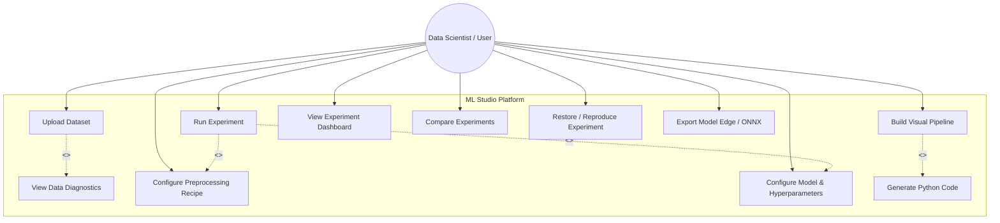
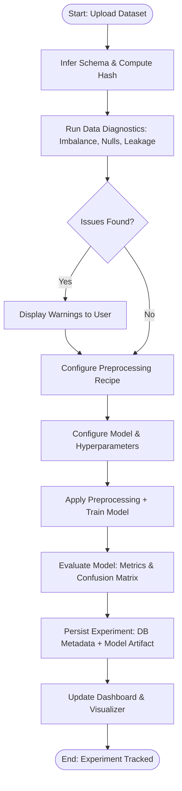
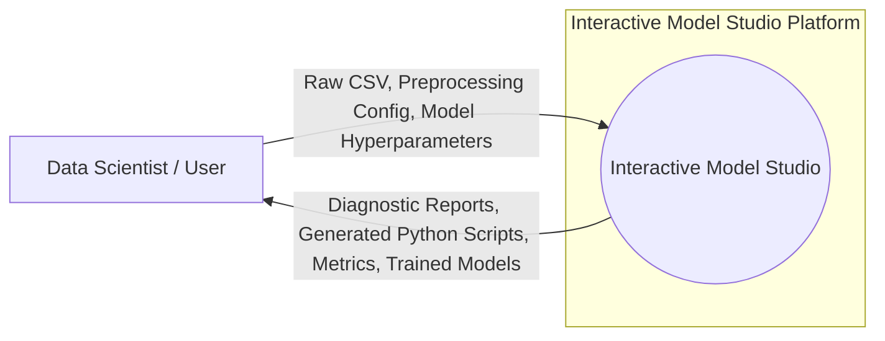
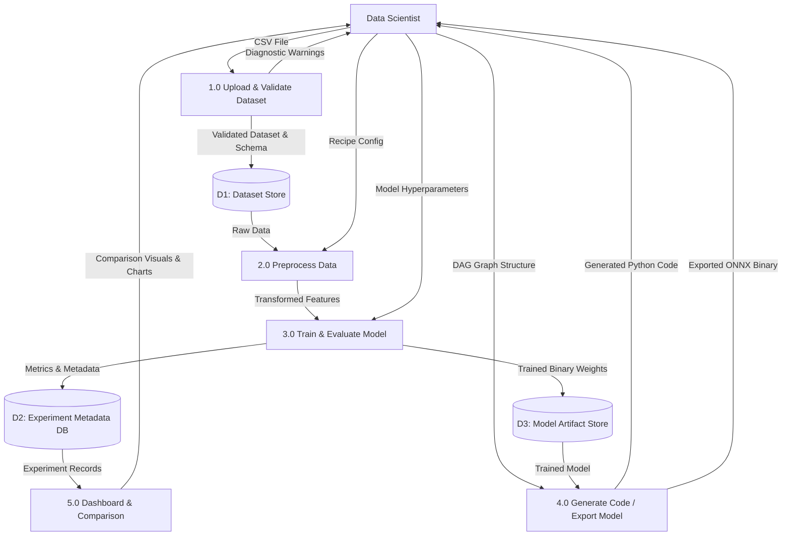
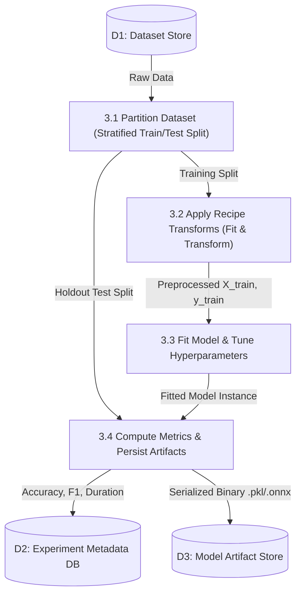

# UCS503 - Software Engineering Lab
*(A typical Specimen of Cover Page & Title Page)*

---

# INTERACTIVE ML MODEL STUDIO & VISUAL EXPERIMENT TRACKER

### UCS 503 Software Engineering Project Report
**Mid-Semester Evaluation**

**Submitted by:**
* **(1024030818)** Hiral Gupta
* **(1024030834)** Laxmi Singla
* **(1024030832)** Sagarika

**BE Third Year, CoE / CSE**  
**Group / Batch No:** Batch-3C61  

**Submitted to:**  
Name of the Faculty  
*Computer Science and Engineering Department*  
*Thapar Institute of Engineering and Technology (TIET), Patiala*  

---

## TABLE OF CONTENTS

| S.No. | Assignment / Section | Page No. |
| :--- | :--- | :--- |
| **1.** | **Project Selection Phase** | **3** |
| 1.1 | Software Bid | 3 |
| 1.2 | Project Overview | 4 |
| **2.** | **Analysis Phase** | **6** |
| 2.1 | Use Cases | 6 |
| 2.1.1 | Use-Case Diagrams & Actor Definition | 6 |
| 2.1.2 | Use Case Templates (UC-01 to UC-04) | 7 |
| 2.2 | Activity Diagram and Swimlane Diagrams | 9 |
| 2.3 | Data Flow Diagrams (DFDs) | 11 |
| 2.3.1 | DFD Level 0 (Context Level Diagram) | 11 |
| 2.3.2 | DFD Level 1 (5 Core Processes & 3 Data Stores) | 12 |
| 2.3.3 | DFD Level 2 (Detailed Functional Decomposition) | 13 |
| 2.4 | Software Requirement Specification (SRS) in IEEE Format | 14 |
| 2.4.1 | Introduction & Overall Description | 14 |
| 2.4.2 | Specific Functional Requirements (FR-01 to FR-08) | 15 |
| 2.4.3 | Non-Functional Requirements (NFR-01 to NFR-05) | 17 |
| 2.5 | User Stories and Story Cards | 18 |
| **Appendix** | **System Architecture, Team Responsibility Matrix & Roadmap** | **20** |

---

## 1. Project Selection Phase

### 1.1 Software Bid

#### 1.1.1 Problem Statement & Background
In standard machine learning workflows, data scientists, ML practitioners, and computer science students repeatedly write boilerplate Python code for identical repetitive tasks: importing raw datasets, checking null values, encoding categorical features, scaling numeric ranges, trying multiple candidate classifiers, configuring hyperparameters, and calculating evaluation metrics.

After executing 20 to 50 iterations inside ad-hoc Jupyter notebooks, practitioners face acute cognitive fatigue and disorganized experiments. Critical operational context is routinely lost:
* *Which exact dataset version produced 93.4% accuracy?*
* *Which imputation technique was applied to the missing columns?*
* *What random seed was specified?*
* *Where is the serialized model binary stored on disk?*

Jupyter notebooks degrade into cluttered files (e.g., `model_v3_really_final.ipynb`), leaving teams unable to reproduce their best results or cleanly deploy models.

#### 1.1.2 Proposed Technical Solution
**Interactive ML Model Studio & Visual Experiment Tracker** provides an integrated, web-based visual experimentation platform that replaces fragmented scripts with an interactive, auditable, and reproducible workflow. The system combines:
1. **Visual Pipeline Builder:** Drag-and-drop node graph canvas built using **React Flow**.
2. **Transparent Python Code Generation:** Dynamic synthesis of idiomatic `scikit-learn` scripts displayed inside **Monaco Editor**.
3. **Pre-Training Data Diagnostics:** Rule-based data hygiene checks preventing wasted training compute.
4. **Automated Experiment Tracking:** Structured recording of configurations, parameters, and metrics in **PostgreSQL**.
5. **Edge / Browser Model Export:** Model conversion via `sklearn-onnx` for client-side zero-latency inference using **ONNX Runtime Web**.

#### 1.1.3 Feasibility Analysis
* **Technical Feasibility:** The project builds upon established, battle-tested open-source libraries: React 18, React Flow, and Monaco Editor on the frontend; FastAPI and Python 3.11+ on the backend; scikit-learn and XGBoost for model training; and PostgreSQL for ACID-compliant metadata storage.
* **Operational Feasibility:** Seamless browser interface requiring zero local environment configuration for basic experimentation. Proactive diagnostics eliminate human configuration errors.
* **Economic & Resource Feasibility:** Zero proprietary licensing fees. Low compute footprint for tabular ML workloads, with edge deployment eliminating cloud server operational costs.

#### 1.1.4 Risk Analysis & Mitigation Strategies
* **Risk 1: Browser UI Freezing on Complex Pipeline Graphs**  
  *Mitigation:* Decouple graph rendering from heavy ML computation; execute all data transformations and training asynchronously on the FastAPI backend.
* **Risk 2: Discrepancy Between Visual DAG and Generated Python Script**  
  *Mitigation:* Enforce a single canonical JSON contract (`pipeline_schema.md`) shared strictly between the frontend pipeline parser and the backend code generator.
* **Risk 3: Silent Data Quality Failures (Garbage-In, Garbage-Out)**  
  *Mitigation:* Embed an automated rule-based pre-training data diagnostics engine that alerts users to missingness, severe class imbalance, high cardinality, and target leakage before fitting begins.

---

### 1.2 Project Overview

#### 1.2.1 Product Vision & Core Objectives
The platform empowers developers and researchers with visual simplicity without stripping away code ownership:
* **End-to-End Workflow:** Single unified studio covering Data Ingestion $
ightarrow$ Profiling & Diagnostics $
ightarrow$ Visual Pipeline $
ightarrow$ Training $
ightarrow$ Evaluation $
ightarrow$ Model Registry $
ightarrow$ Comparison & Edge Export.
* **Zero Black-Box Trap:** Every node added to the visual graph immediately writes readable, standard scikit-learn code into Monaco Editor.
* **Guaranteed Reproducibility:** Every experiment captures:
  $$	ext{Reproducible Run} = 	ext{Dataset Version} + 	ext{Preprocessing Recipe} + 	ext{ModelConfig} + 	ext{Random Seed}$$

#### 1.2.2 Technology Stack
* **Frontend Layer:** React.js, React Flow (DAG pipeline canvas), Monaco Editor (VS-Code in browser), Chart.js / Recharts.
* **Backend Layer:** FastAPI (High-performance async REST API, Pydantic validation, Pipeline Parser, Code Generator).
* **ML & Diagnostics Engine:** Python, pandas, NumPy, scikit-learn, XGBoost.
* **Storage Layer:** PostgreSQL (Metadata, parameters, recipes, metrics) + Local Filesystem (Model binaries `.pkl`, `.onnx`, scripts `.py`).

#### 1.2.3 Team Responsibility Matrix

| Team Member | Engineering Role | Core Module Ownership & Deliverables |
| :--- | :--- | :--- |
| **Hiral Gupta** (1024030818) | **Data & Backend Core Lead** | Dataset upload REST endpoints, automated schema inference, dataset versioning engine (`v1/v2`), preprocessing recipe persistence, rule-based data diagnostics engine (missingness, class imbalance, leakage), PostgreSQL schema design. |
| **Laxmi Singla** (1024030834) | **ML Engine & Tracking Lead** | Model training & evaluation worker service, cross-validation & metrics computation (accuracy, F1, ROC-AUC, RMSE), model serialization (`.pkl`/`.joblib`), experiment restore logic, and `sklearn-to-ONNX` conversion engine. |
| **Sagarika** (1024030832) | **Frontend, Visual Canvas & Codegen Lead** | React application architecture, React Flow drag-and-drop DAG builder, Monaco code editor integration, pipeline-to-Python codegen module, experiment comparison dashboard, and multi-model trade-off visualization charts. |

---

## 2. Analysis Phase

### 2.1 Use Cases

#### 2.1.1 Use-Case Diagrams & Actor Definition
The sole primary actor is the **Data Scientist / Student (User)** who uploads datasets, configures pipelines, executes runs, and analyzes results.

#### 2.1.2 Structured Use Case Templates

##### Table 2.1: Use Case Specification UC-01
| Field | Specification |
| :--- | :--- |
| **Use Case ID & Name** | **UC-01: Upload Dataset & Automated Pre-Training Diagnostics** |
| **Primary Actor** | Data Scientist / Student |
| **Preconditions** | User is logged in; has a valid tabular dataset file (CSV/Parquet). |
| **Main Success Scenario** | 1. User selects and uploads a tabular CSV file via the UI. 2. Backend validates MIME type, structure, and parses headers using pandas. 3. System computes cryptographic file hash and stores dataset as a new version. 4. Pre-training diagnostic engine evaluates missing values, class imbalance, high-cardinality columns, and target leakage. 5. UI displays comprehensive profile summary and flags actionable quality warnings. |
| **Alternate Flows** | 3a. File is malformed or non-CSV: System rejects upload with descriptive error. 5a. Severe data leakage or 100% null columns detected: UI highlights critical alerts with recommended remedies. |
| **Postconditions** | Dataset version is cataloged in PostgreSQL; data profile & diagnostic flags are accessible for pipeline modeling. |

##### Table 2.2: Use Case Specification UC-02
| Field | Specification |
| :--- | :--- |
| **Use Case ID & Name** | **UC-02: Build Visual Pipeline & Generate Python Code** |
| **Primary Actor** | Data Scientist / Student |
| **Preconditions** | Dataset version has been successfully ingested and selected. |
| **Main Success Scenario** | 1. User opens the React Flow canvas. 2. User drags and drops nodes: Dataset, Imputer, Scaler, Classifier/Regressor, and Evaluation. 3. User connects node handles to specify execution dataflow. 4. Frontend serializes graph topology into canonical Pipeline Schema JSON. 5. Backend code generator maps nodes to scikit-learn classes and synthesizes PEP-8 Python code. 6. Monaco Editor displays formatted Python script in real-time with download options. |
| **Alternate Flows** | 3a. User creates circular connection (cycle): React Flow prevents link and alerts user. 4a. Incompatible node connection (e.g. Scaler directly to Evaluation): Validation engine highlights invalid edge. |
| **Postconditions** | Valid pipeline recipe is stored; clean standalone Python script (.py) is available for inspection and export. |

##### Table 2.3: Use Case Specification UC-03
| Field | Specification |
| :--- | :--- |
| **Use Case ID & Name** | **UC-03: Execute Experiment & Track Model Artifact** |
| **Primary Actor** | Data Scientist / Student |
| **Preconditions** | Valid pipeline recipe and model hyperparameters configured; random seed specified. |
| **Main Success Scenario** | 1. User clicks 'Run Experiment'. 2. Backend assigns unique Experiment ID (e.g. EXP-024) and sets status to QUEUED. 3. ML Training Worker fetches dataset partition and executes preprocessing transforms. 4. Worker fits chosen model (e.g. Random Forest, XGBoost) and logs execution duration. 5. Worker evaluates predictions against holdout test set (Accuracy, F1, ROC-AUC, RMSE). 6. System serializes model binary (.pkl/.joblib) to Artifact Store and writes metadata to PostgreSQL. 7. Status changes to COMPLETED; updated metrics stream to dashboard. |
| **Alternate Flows** | 4a. Out of Memory or training convergence error occurs: System catches exception, updates status to FAILED, logs traceback, and alerts user without crashing application. |
| **Postconditions** | Immutable experiment record persisted; trained model artifact registered and available for comparison. |

##### Table 2.4: Use Case Specification UC-04
| Field | Specification |
| :--- | :--- |
| **Use Case ID & Name** | **UC-04: Multi-Experiment Comparison & ONNX Edge Export** |
| **Primary Actor** | Data Scientist / Student |
| **Preconditions** | At least two completed experiment runs exist for the project. |
| **Main Success Scenario** | 1. User navigates to Comparison View and selects candidate runs (e.g. EXP-01, EXP-02, EXP-03). 2. Dashboard displays side-by-side performance matrix (Accuracy, F1, Latency). 3. Visual charts plot performance vs. training time trade-offs. 4. User identifies optimal champion model. 5. User requests Edge Export: backend converts model to ONNX binary via sklearn-onnx. 6. User runs local in-browser inference test using ONNX Runtime Web. |
| **Alternate Flows** | 5a. Model contains custom non-standard operator unsupported by ONNX: System notifies user and offers standard .pkl/.joblib download as fallback. |
| **Postconditions** | Champion model selected and versioned; ONNX model file generated for zero-latency client deployment. |

---

### 2.2 Activity Diagram and Swimlane Diagrams

#### 2.2.1 Activity Diagram — Run Experiment Workflow

#### 2.2.2 Cross-Functional Swimlane Diagram

| Step | Lane 1: User / Frontend (React) | Lane 2: Backend API (FastAPI) | Lane 3: ML Engine & Storage |
| :--- | :--- | :--- | :--- |
| **1** | Selects & uploads CSV file | Validates MIME type & payload | Ingests raw file into Dataset Store (D1) |
| **2** | Views data quality warnings & summary stats | Computes missingness, cardinality, leakage | Persists schema & profile in PostgreSQL (D2) |
| **3** | Assembles visual DAG on React Flow canvas | Parses node JSON & validates DAG ordering | Translates graph into clean Python code |
| **4** | Configures hyperparameters & clicks 'Run' | Assigns Experiment ID; sets status QUEUED | Loads dataset partition & preprocessing recipe |
| **5** | Observes progress indicator | Dispatches job to training worker | Fits model, logs duration & calculates metrics |
| **6** | Receives completed run notification | Writes HTTP 201 response with metrics | Saves .pkl/.onnx to D3; logs record to D2 |
| **7** | Explores interactive charts & comparison | Serves comparative analytics API | Fetches run records from PostgreSQL |

---

### 2.3 Data Flow Diagrams (DFDs)

#### 2.3.1 DFD Level 0 (Context Level Diagram)

#### 2.3.2 DFD Level 1 (5 Core Processes & 3 Data Stores)

#### 2.3.3 DFD Level 2 (Decomposition of Process 3.0: Train & Evaluate Model)

---

### 2.4 Software Requirement Specification (SRS) in IEEE Format

#### 2.4.1 Specific Functional Requirements

| Req ID | Requirement Title | Description & Processing Logic | Priority |
| :--- | :--- | :--- | :--- |
| **FR-01** | Dataset Ingestion & Versioning | The system shall allow users to upload tabular CSV files, automatically infer column data types, calculate missing counts, and assign an immutable dataset version identifier (`v1`, `v2`). | High |
| **FR-02** | Pre-Training Data Diagnostics | The system shall perform automated rule-based checks prior to training, flagging missing values (>10%), class imbalance (>80/20 ratio), high-cardinality categoricals (>1000 unique values), and suspected data leakage features. | High |
| **FR-03** | Visual DAG Pipeline Builder | The system shall provide a React Flow canvas enabling users to drag, drop, and link Preprocessing nodes (Imputer, Scaler, Encoder) and Model nodes (Random Forest, XGBoost, Logistic Regression). | High |
| **FR-04** | Real-Time Python Code Generation | The system shall translate the visual node graph into syntactically valid scikit-learn Python code, rendered dynamically in an embedded Monaco Editor with one-click export to `.py`. | High |
| **FR-05** | Experiment Execution Lifecycle | The system shall execute model training jobs according to a formal lifecycle: `CREATED -> QUEUED -> RUNNING -> COMPLETED` or `FAILED`, without bringing down the application upon training exceptions. | High |
| **FR-06** | Comprehensive Metric Logging | The system shall record wall-clock training time, hyperparameter snapshots, random seed, and compute metrics (Accuracy, Precision, Recall, F1, ROC-AUC, MAE, RMSE, R²). | High |
| **FR-07** | Multi-Experiment Comparison | The system shall provide a tabular and graphical comparison view allowing users to select multiple runs and visualize performance vs. latency trade-offs. | Medium |
| **FR-08** | ONNX Edge Model Export | The system shall convert compatible trained scikit-learn models into ONNX binary format using `sklearn-onnx` for client-side browser execution via ONNX Runtime Web. | Medium |

#### 2.4.2 Non-Functional Requirements (NFRs)
* **NFR-01: Performance & Responsiveness:** Schema inference and data diagnostic evaluation shall complete in under 2.0 seconds for tabular files up to 50MB. UI interactions on the React Flow canvas shall maintain a 60 FPS rendering rate.
* **NFR-02: Reproducibility & Integrity:** Given the identical dataset version, preprocessing recipe, model hyperparameters, and random seed, repeated executions shall produce bit-identical evaluation metrics.
* **NFR-03: Architectural Decoupling:** User configuration (`ModelConfig`) must be strictly decoupled from physical trained files (`ModelArtifact`) in the PostgreSQL schema.
* **NFR-04: Reliability & Fault Isolation:** Model training exceptions (e.g. non-convergence, matrix singularity) shall be caught gracefully, logging stack traces to the database without crashing the web service.
* **NFR-05: Usability & Code Transparency:** Generated Python scripts in Monaco Editor must be fully formatted according to PEP-8 guidelines and runnable independently outside the studio environment.

---

### 2.5 User Stories and Story Cards

| Story ID | User Story Statement | Acceptance Criteria (Given-When-Then) | Pts / Prio | Owner |
| :--- | :--- | :--- | :--- | :--- |
| **US-01** | As a data science student, I want to upload a CSV dataset and see automatic data diagnostics, so that I don't waste time training models on broken data. | **Given** a CSV file with 15% nulls in Age and an 85/15 target imbalance, **When** I upload the file, **Then** the studio displays warning banners suggesting median imputation and highlights class imbalance. | 5 Pts High | **Hiral Gupta** |
| **US-02** | As a beginner ML practitioner, I want to visually assemble a pipeline using drag-and-drop nodes, so that I can understand the ML workflow without getting stuck on boilerplate syntax. | **Given** the React Flow canvas, **When** I link Dataset $
ightarrow$ Scaler $
ightarrow$ Random Forest $
ightarrow$ Evaluation, **Then** the canvas validates all connections and highlights data flow direction with active edges. | 8 Pts High | **Sagarika** |
| **US-03** | As an experienced software developer, I want to see the Python code corresponding to my visual pipeline in Monaco Editor, so that I can verify the code and export it as a standalone `.py` script. | **Given** a completed visual pipeline, **When** I toggle the Code View panel, **Then** Monaco Editor displays clean scikit-learn Python code matching my node choices, with an 'Export .py' button. | 8 Pts High | **Sagarika** |
| **US-04** | As an ML researcher, I want every experiment run to record the exact dataset version, recipe, hyperparameters, and seed, so that my findings are 100% reproducible. | **Given** a configured experiment run, **When** I click 'Run Experiment', **Then** PostgreSQL saves an immutable record linking Dataset Version, Recipe, ModelConfig, and Seed alongside metrics. | 5 Pts High | **Laxmi Singla** |
| **US-05** | As an analyst, I want to compare multiple trained models side-by-side on an interactive dashboard, so that I can select the best model considering both accuracy and training time. | **Given** 3 completed runs (Logistic Regression, Random Forest, XGBoost), **When** I open the Comparison view, **Then** the studio displays a comparison table and visual trade-off chart highlighting the best model. | 5 Pts Medium | **Sagarika** |
| **US-06** | As a web developer, I want to export trained models to ONNX format, so that I can run real-time inference directly in the client browser without paying for a cloud inference backend. | **Given** a trained compatible scikit-learn model, **When** I click 'Export ONNX', **Then** the system converts the model to `.onnx` and provides a browser preview powered by ONNX Runtime Web. | 5 Pts Medium | **Laxmi Singla** |

---

## Appendix: Milestones, Integration & Development Phases

### Development Phases & Schedule

| Phase | Engineering Focus & Key Deliverables | Duration | Status |
| :--- | :--- | :--- | :--- |
| **Phase 0** | Scope, Software Requirements & Schema Contract (Pipeline JSON Schema locked) | 3–5 Days | Completed |
| **Phase 1** | Data Layer: CSV upload, schema inference, dataset versioning, pre-training diagnostics | Week 1 | Completed |
| **Phase 2** | ML Engine: Preprocessing pipeline, model training worker, metrics computation, artifact persistence | Week 2 | Completed |
| **Phase 3** | Visual Studio: React Flow canvas, Monaco Editor integration, pipeline-to-Python codegen | Week 3 | In Progress |
| **Phase 4** | Analytics & Export: Experiment tracking dashboard, multi-model comparison, ONNX edge export | Weeks 4–5 | In Progress |
| **Phase 5** | System Integration, E2E Testing, Demo Datasets, Video & Final Project Report | Week 6 | Scheduled |

### Integration Touchpoints
* **Touchpoint 1 (Schema Contract):** All three team members co-designed the canonical JSON Schema (`pipeline_schema.md`) ensuring frontend state matches backend Pydantic models.
* **Touchpoint 2 (Data ↔ ML Engine):** Hiral's data persistence and diagnostics feed directly into Laxmi's training worker.
* **Touchpoint 3 (ML Engine ↔ Frontend):** Laxmi's experiment metrics and model artifacts feed directly into Sagarika's React comparison dashboard and Monaco code display.
